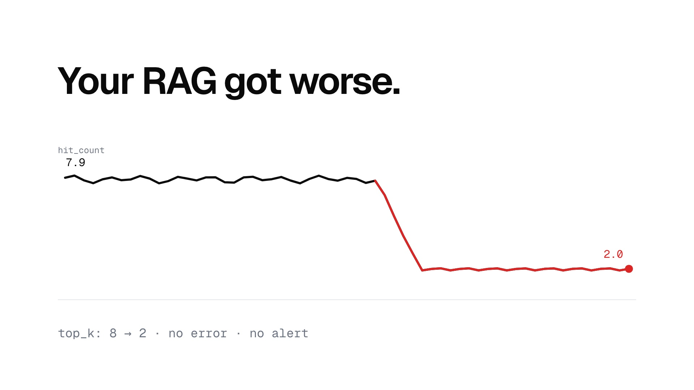

# Driftline

**Your RAG doesn't crash. It drifts.** Driftline notices when a RAG application quietly gets worse, sends the incident to the right specialist agent, proves a fix in a sandbox and opens the pull request. A person reviews and merges; Driftline never does.

**▶ [Watch the 20-second film](docs/site/video/brag.mp4)** · **[Project site](https://abh2050.github.io/driftline/)** · built on Azure with Microsoft Foundry, Agent Framework, Container Apps and API Management.

[](docs/site/video/brag.mp4)

## What it does, in one incident

1. **Detect.** patient-rag (the monitored RAG app) emits telemetry. The detector keeps EWMA baselines with CUSUM over one-minute windows. When `top_k` drops from 8 to 2, `hit_count` falls from 7.9 to 2.0 with no errors, and the router's **D1** decision confirms the breach is real.
2. **Route.** **D2** sets severity and **D3** picks a specialist (retrieval, prompt, index or performance) from scored options. Under 0.6 confidence, a person decides.
3. **Investigate.** The specialist agent reads the repository and runs named KQL queries through an MCP gateway (API Management) under its own managed identity, then returns a structured root cause.
4. **Prove.** **D4** chooses PR, runbook or escalate. A PR fix is evaluated in a sandbox (the running config plus the change, on 40 golden questions against the baseline), and **D5** accepts it only if the gate passed.
5. **Propose.** **D6** clears every write before it happens, and the PR opens through a GitHub App. Runbooks wait in the console's approvals inbox and resume from a checkpoint.


## Results (measured)

| | |
|---|---|
| Faults detected | **21 / 21** (7 fault types × 3 trials, replayed at 1440×) |
| False alarms | **0** in 48 h of clean traffic |
| Right action (PR, runbook, escalate) | **100%** |
| Routed to the right specialist | **95%** |
| Proposed fixes passing the sandbox gate | **100%** |
| Cost per incident | **$0.07** (agents, decisions, sandbox) |
| Safety eval | **55 / 55** attacks blocked; the report names the blocking layer for each |
| Weak spot | severity (D2) matches labels 52% of the time, usually one level off |

Reports: [system (layer 2b)](evals/reports/2026-10-11-system.md) · [safety (layer 3)](evals/reports/2026-10-10-layer3.md) · [router (layer 2a)](evals/reports/2026-10-11-router.md) · [RAG quality (layer 1)](evals/reports/).

### Router benchmark (layer 2a)

Each decision is a scored JSON distribution from a Foundry model, benchmarked against a hand-written rules floor on 1,200 synthetic incidents per decision type, with 8 paraphrase perturbations each.

| Client | D3 routing | D4 action | D3 ECE | D3 flip rate | D3 p95 | $ / 1k decisions |
|---|---|---|---|---|---|---|
| **gpt-5-mini** (production) | **89.3%** | 91.0% | 0.091 | 8.2% | 4.1 s | $0.72 |
| gpt-oss-120b | 86.7% | 92.4% | 0.118 | 10.6% | 2.3 s | $0.23 |
| gpt-4.1-mini | 74.2% | 90.3% | 0.152 | 9.4% | 1.6 s | $0.41 |
| rules floor | 87.8% | 92.8% | 0.178 | 1.0% | – | $0 |

Microsoft-Decision-1, the spec's intended router, was not available to this subscription; see [ADR 0001](docs/adr/0001-scope-change-llm-router.md) and [ADR 0010](docs/adr/0010-design-decisions.md).

## The console

| | |
|---|---|
|  |  |
| Incident: routing scores with margins, root cause, sandbox evaluation, D5/D6, PR | Live feed over server-sent events |
|  |  |
| Runbooks and escalations waiting for a person | Router benchmark with reliability diagram |

## Architecture


- **No keys anywhere.** Every service has its own managed identity, and so does each of the seven agents, so the gateway can tell them apart. The console signs in with Entra ID using a managed identity as its federated credential, and CI uses GitHub OIDC. The only secret is the GitHub App key, in Key Vault, readable by one identity.
- **Four layers on every write:** prompt shields on tool results, D6, APIM policy (no merge, no push to main, per-agent allowlists), and branch protection with human review.
- **One trace per incident.** OpenTelemetry flows through a collector into Log Analytics and Application Insights; a workbook shows the incident timeline, trace waterfall, agent and model latency, router confidence, cost per incident and eval trends.


## Repository

| Path | What |
|---|---|
| `apps/` | patient-rag, traffic-gen, replay, ingest, detector, router, orchestrator, sandbox-runner, github-mcp, kql-tool, ops-api, console, otel-collector |
| `packages/driftline-common` | schemas, decision client, telemetry, auth, audit |
| `infra/` | Bicep for everything (`azd up`), APIM policies, workbook |
| `evals/` | layer 1 (RAG quality), 2a (router), 2b (system), 3 (safety); reports |
| `synth/`, `data/` | deterministic synthetic corpus, golden set, routing cases and telemetry |
| `docs/` | [architecture](docs/architecture.md), [threat model](docs/threat-model.md), [Well-Architected review](docs/well-architected.md), [cost model](docs/cost-model.md), [AWS → Azure](docs/aws-to-azure.md), [MCP clients](docs/mcp-clients.md), [Copilot Studio governance pack](docs/copilot-studio/), [demo script](docs/demo-script.md), [ADRs](docs/adr/) |

## Run it

Prerequisites: an Azure subscription with Foundry quota for the models in `infra/main.parameters.json`, plus `az`, `azd`, `uv`, Docker and Node 22.

```bash
azd auth login && az login
azd up                      # provisions everything, the Entra app and grants, seeds the index, deploys
```

A new environment needs two human steps, both in [docs/HUMAN_STEPS.md](docs/HUMAN_STEPS.md): create the GitHub App (and store its key in Key Vault), and sign in to the console. Then:

```bash
uv run python -m scripts.replay fault:F3:1 --run-id demo   # or use the console's Demo page
uv run driftline-eval layer3                                # safety eval inside Azure
azd down --purge                                            # tear it all down
```

Built from a written specification ([docs/SPEC.md](docs/SPEC.md)), phase by phase, with every deviation recorded as an ADR.
