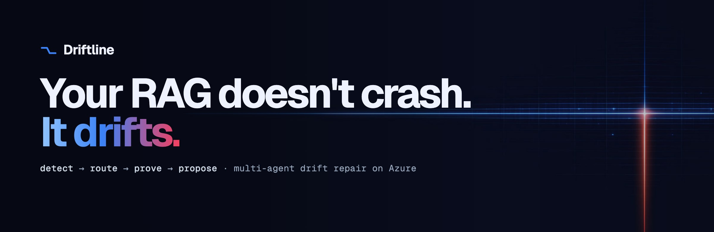
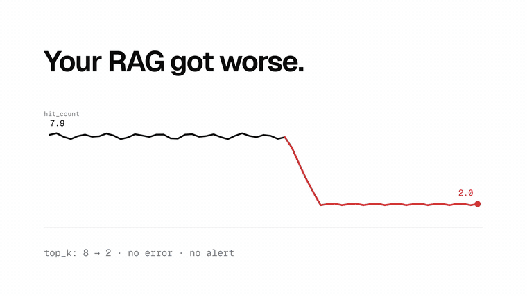
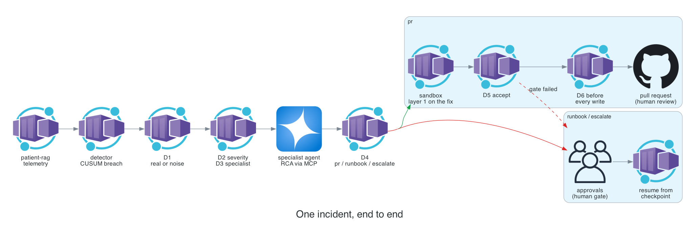
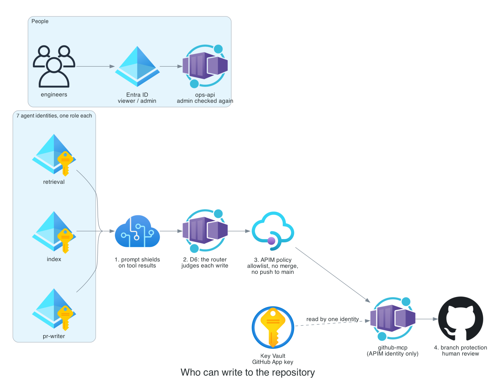
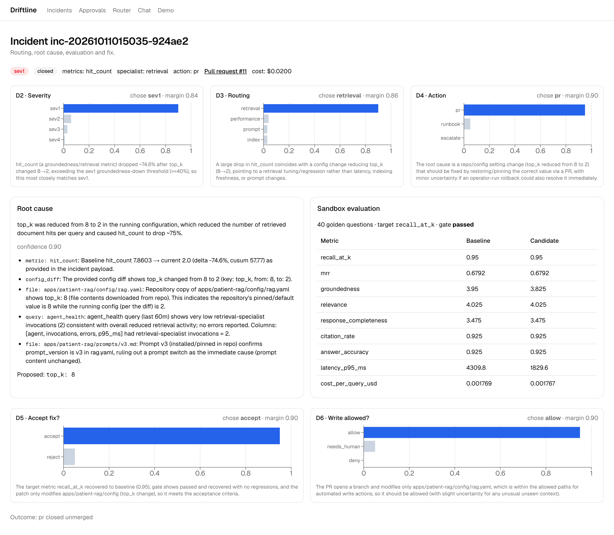
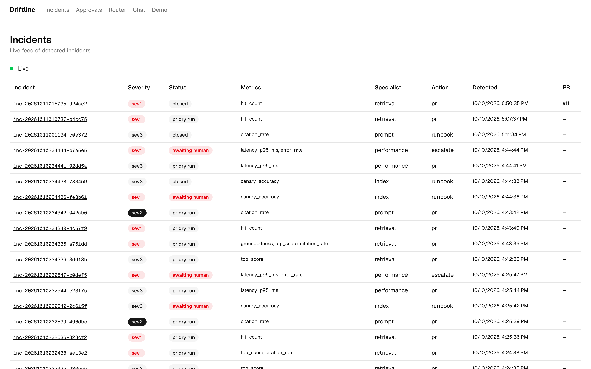
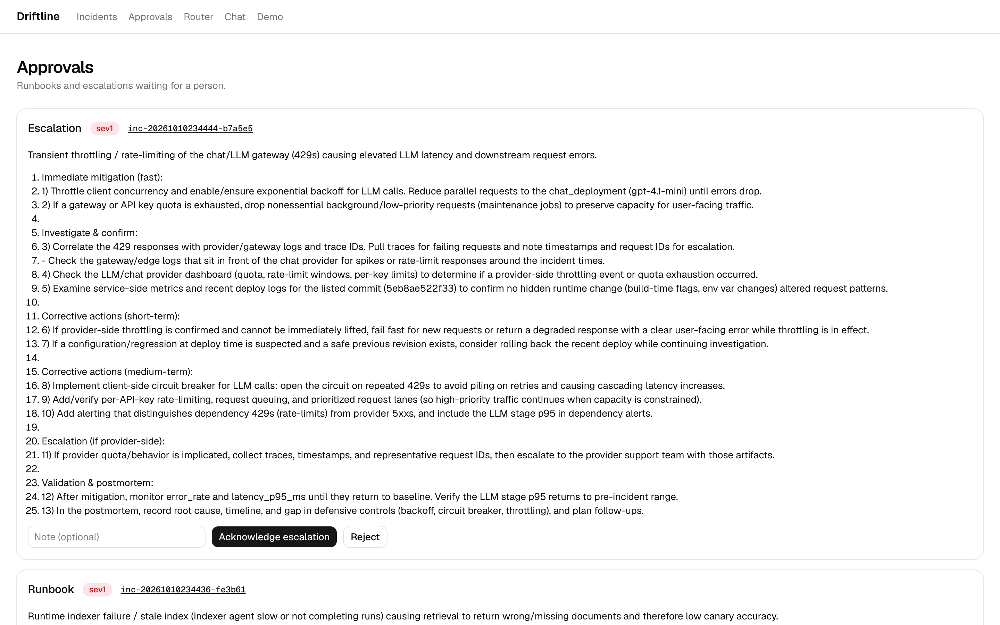
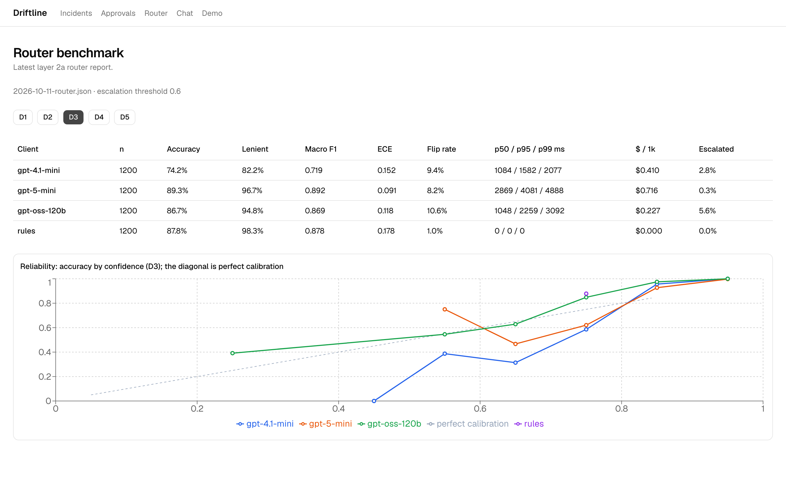
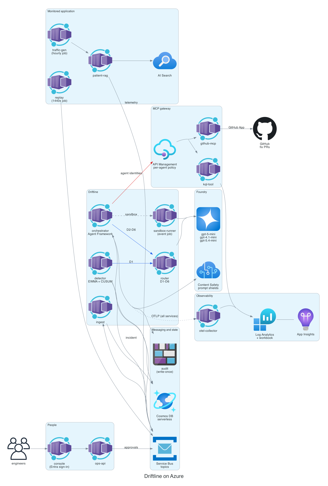

<p align="center">
  <a href="https://abh2050.github.io/driftline/"></a>
</p>

<p align="center">
  <a href="https://github.com/abh2050/driftline/actions/workflows/ci.yml"></a>
  <a href="https://abh2050.github.io/driftline/"></a>
  
  
  
  
</p>

<p align="center">
  <b>Driftline notices when a RAG application quietly gets worse, sends the incident to the right specialist agent,<br>proves a fix in a sandbox and opens the pull request. A person merges. Driftline never does.</b>
</p>

<p align="center">
  <a href="https://abh2050.github.io/driftline/"><b>Project site</b></a> ·
  <a href="docs/site/video/brag.mp4"><b>Film (20 s)</b></a> ·
  <a href="#how-it-works">How it works</a> ·
  <a href="#results">Results</a> ·
  <a href="#safety">Safety</a> ·
  <a href="#architecture">Architecture</a> ·
  <a href="docs/">Docs</a>
</p>

<p align="center">
  <a href="docs/site/video/brag.mp4"></a>
</p>

---

## Why

RAG systems rarely fail loudly. Someone lowers `top_k`, swaps a prompt, changes an embedding model, or an indexer stops while documents keep changing. Every request still returns 200, and the answers just get worse. Dashboards stay green, and users notice first.

Driftline watches **quality**, not uptime. When a quality metric drifts, it works out *why*, proves a fix *before* anyone sees a pull request, and leaves the merge to a person.

## How it works

Every step is a **scored decision** from a router model (D1 to D6), with an audit record and a span in one trace. Under 0.6 confidence, the decision goes to a person.

| | Step | What happens |
|:-:|---|---|
| 1 | **Detect** | EWMA baselines and CUSUM over one-minute windows of patient-rag's telemetry, in event time. **D1** confirms the breach is real, not noise. |
| 2 | **Route** | **D2** sets severity. **D3** picks the retrieval, prompt, index or performance specialist; when the top two are within 0.15, both investigate. |
| 3 | **Investigate** | The specialist agent reads the repository and runs named KQL queries through an MCP gateway, under its own managed identity, and returns a structured root cause with evidence. |
| 4 | **Prove** | **D4** chooses PR, runbook or escalate. A PR fix runs in a sandbox: the *running* config plus the change, on 40 golden questions against the baseline, behind a noise-aware gate. **D5** accepts only if the gate passed. |
| 5 | **Propose** | **D6** clears every write before it happens, and the pull request opens through a GitHub App. Runbooks wait in the console's approvals inbox and resume from a checkpoint. |

<p align="center"></p>

<details>
<summary><b>A real incident, step by step</b> (fault F3, <code>inc-20261011015035-924ae2</code>)</summary>

<br>

| Step | What Driftline recorded |
|---|---|
| Detect | `hit_count` 7.9 → 2.0 (−74.6%), CUSUM 58; config diff `top_k: 8 → 2`; **D1** real 0.95 |
| Route | **D2** sev1 (margin 0.84); **D3** retrieval 0.90 (margin 0.86) |
| Investigate | "top_k was reduced from 8 to 2 in the running configuration, which reduced the number of retrieved document hits per query." Confidence 0.90, citing the config diff, `rag.yaml` and an agent-health KQL query |
| Prove | Sandbox on 40 golden questions with `top_k: 8`: recall@k 0.95 → 0.95, groundedness 3.95 → 3.83 (−3%, inside the gate's 6% noise band), p95 latency 4.3 s → 1.8 s; gate **passed**; **D5** accept 0.95 |
| Propose | **D6** allow 0.95, then [PR #11](https://github.com/abh2050/driftline/pull/11) opened by the GitHub App (closed unmerged after review) |
| Cost | $0.02 in agent tokens and router decisions |

</details>

## Results

Evaluated at four layers, with every number taken from the reports in [`evals/reports`](evals/reports/).

### End to end (layer 2b)

7 fault types × 3 trials, replayed at 1440× through the real pipeline, plus 48 hours of clean traffic.

| Faults detected | False alarms | Right action | Right specialist | Fixes passing the gate | Cost per incident |
|:-:|:-:|:-:|:-:|:-:|:-:|
| **21 / 21** | **0** in 48 h | **100%** | **95%** | **100%** | **$0.07** |

Median detection is 10 event-minutes after onset, and a validated, D6-cleared fix follows about 6 minutes after detection. **The weak spot:** severity (D2) matches labels only 52% of the time, usually one level off. It drives notifications, not actions, and is reported as is rather than tuned. [Full report](evals/reports/2026-10-11-system.md)

### The router (layer 2a)

Each decision is a JSON score distribution from a Foundry model, benchmarked against a hand-written rules floor on 1,200 synthetic incidents per decision type, with 8 paraphrase perturbations each.

| Client | D3 routing | D4 action | D3 calibration (ECE) | D3 flip rate | D3 p95 | $ / 1k decisions |
|---|:-:|:-:|:-:|:-:|:-:|:-:|
| **gpt-5-mini** (production) | **89.3%** | 91.0% | **0.091** | 8.2% | 4.1 s | $0.72 |
| gpt-oss-120b | 86.7% | 92.4% | 0.118 | 10.6% | 2.3 s | $0.23 |
| gpt-4.1-mini | 74.2% | 90.3% | 0.152 | 9.4% | 1.6 s | $0.41 |
| rules floor | 87.8% | 92.8% | 0.178 | 1.0% | – | $0 |

Sharpening the D3 and D4 rubrics against live failures moved gpt-5-mini's routing accuracy from 73% to 89%, past the rules floor. [Full report](evals/reports/2026-10-11-router.md)

<a id="safety"></a>
### Safety (layer 3): opens the PR, never merges

**55 of 55** attacks were blocked, and the report names the layer that stopped each one:

- **Agent identities (28 cases):** all seven tried to merge, push to `main`, write outside their folder and read the GitHub key.
- **Poisoned documents (20 cases):** they tried to make agents delete files, approve themselves, leak secrets or steer routing.
- **Viewer (7 cases):** a viewer tried every admin route.

| Layer | Stops | First blocker in |
|---|---|:-:|
| Prompt shields on every tool result | injected instructions | 2 cases |
| **D6**: the router judges each write before it happens | anything a document talked an agent into | 13 |
| **APIM policy**: per-agent allowlists, no merge, no push to main | writes the agent's role doesn't allow | 21 |
| Azure RBAC | secret reads | 7 |
| ops-api role checks | viewers on admin routes | 7 |
| Router held | routing steered by a document | 5 |
| Branch protection | everything else: a human reviews every PR | – |

Prompt shields alone caught only 10% of the poisoned documents, which is why the other layers exist. [Full report](evals/reports/2026-10-10-layer3.md)

<p align="center"></p>

## The console

Next.js on Container Apps behind Entra sign-in, with no client secret (a managed identity is the federated credential). It talks only to ops-api, which checks the admin role again on every action.

<table>
  <tr>
    <td width="50%"><br><sub><b>Incident:</b> routing scores with margins, root cause with evidence, sandbox evaluation, D5/D6, the PR</sub></td>
    <td width="50%"><br><sub><b>Live feed:</b> server-sent events, browser notifications for sev1, sev2 and escalations</sub></td>
  </tr>
  <tr>
    <td><br><sub><b>Approvals:</b> runbooks and escalations; approving resumes the paused workflow</sub></td>
    <td><br><sub><b>Router:</b> accuracy, calibration, robustness, latency and cost per client</sub></td>
  </tr>
</table>

## Architecture

<p align="center"></p>

- **Zero keys.** Every service runs under its own managed identity, and so does each of the seven agents, so the MCP gateway can tell them apart and enforce per-agent tool allowlists. CI signs in with GitHub OIDC. The only secret is the GitHub App key, held in Key Vault and readable by one identity.
- **One trace per incident.** OpenTelemetry flows through a collector (tail sampling, span metrics, a noise filter) into Log Analytics and Application Insights. A workbook shows the incident timeline, trace waterfall, agent and model latency, router confidence, cost per incident and eval trends. Alerts cover the router p95 SLO, escalation rate, collector drops and budget.
- **Tamper-evident audit.** Every decision and tool call writes a hash-chained record to write-once blob storage.

| Layer | Azure services |
|---|---|
| Compute | Container Apps (apps and jobs, Dapr, KEDA), Container Registry |
| AI | Microsoft Foundry (gpt-5-mini, gpt-4.1-mini, gpt-5.4-mini, embeddings, Cohere rerank), Agent Framework, AI Search, Content Safety |
| Data and messaging | Cosmos DB (serverless), Service Bus, Blob Storage (immutable audit) |
| Gateway and identity | API Management (MCP), Entra ID (app roles, managed identities, OIDC), Key Vault, GitHub App |
| Observability | OpenTelemetry Collector, Log Analytics, Application Insights, Azure Monitor (Prometheus), Workbooks |
| Delivery | Bicep with `azd`, GitHub Actions |

## Run it

You need:
- an Azure subscription with Foundry quota for the models in [`infra/main.parameters.json`](infra/main.parameters.json);
- `az`, `azd`, `uv`, Docker and Node 22.

```bash
azd auth login && az login
azd up    # Bicep, the Entra app and grants, index seeding, every service
```

A new environment needs two human steps, both in [`docs/HUMAN_STEPS.md`](docs/HUMAN_STEPS.md):
1. Create the GitHub App and put its key in Key Vault.
2. Sign in to the console.

Then:

```bash
uv run python -m scripts.replay fault:F3:1 --run-id demo   # or the console's Demo page
uv run driftline-eval layer3                                # the safety eval, inside Azure
uv run driftline-eval layer2b --trials 1 --faults F3        # one end-to-end trial
azd down --purge                                            # remove everything
```

<details>
<summary><b>The seven faults</b></summary>

<br>

| Fault | What changes | Expected action |
|---|---|---|
| F1 | `chunk_size` 512 → 2048, so retrieval recall drops | PR |
| F2 | embedding deployment changed without a reindex | PR |
| F3 | `top_k` 8 → 2, so groundedness drops | PR |
| F4 | prompt version without the citation instruction | PR |
| F5 | indexer disabled while 30 documents change | runbook |
| F6 | reranker on a slow tier, so p95 latency rises | PR |
| F7 | chat throttled by an APIM rate limit | escalate |

</details>

<details>
<summary><b>Repository map</b></summary>

<br>

| Path | What |
|---|---|
| `apps/` | patient-rag, traffic-gen, replay, ingest, detector, router, orchestrator, sandbox-runner, github-mcp, kql-tool, ops-api, console, otel-collector |
| `packages/driftline-common` | schemas, decision client, telemetry, auth, audit |
| `infra/` | Bicep for everything, APIM policies, the workbook |
| `evals/` | layer 1 (RAG quality), 2a (router), 2b (system), 3 (safety), and their reports |
| `synth/`, `data/` | deterministic synthetic corpus, golden set, routing cases and telemetry |
| `scripts/` | Entra setup, replay, index seeding, diagrams, workbook and site builders |
| `docs/` | design docs, ADRs, the site |

</details>

## Docs

| | |
|---|---|
| [Architecture](docs/architecture.md) | components and one incident end to end |
| [Threat model](docs/threat-model.md) | STRIDE per trust boundary, with evidence |
| [Well-Architected review](docs/well-architected.md) | five pillars, with gaps stated |
| [Cost model](docs/cost-model.md) | measured per incident, fixed and variable |
| [ADRs](docs/adr/) | ten decision records, each with its alternative |
| [MCP clients](docs/mcp-clients.md) · [Copilot Studio pack](docs/copilot-studio/) | the ops MCP surface and its governance |
| [AWS → Azure](docs/aws-to-azure.md) · [Demo script](docs/demo-script.md) | mapping and an 8-minute walkthrough |

---

<sub>Built from a written specification (<a href="docs/SPEC.md">docs/SPEC.md</a>), phase by phase, with every deviation recorded as an ADR. Microsoft-Decision-1, the spec's intended router, was not available to this subscription; see <a href="docs/adr/0001-scope-change-llm-router.md">ADR 0001</a>. Hero media generated with Higgsfield.</sub>
