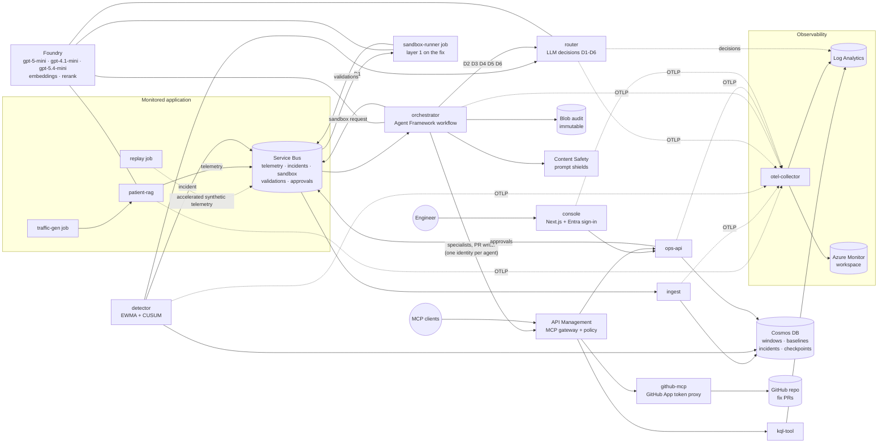

# Driftline architecture

Driftline watches a RAG application, **patient-rag**, for quality drift. When it finds drift, it works out the cause with specialist agents, proves a fix in a sandbox, and opens a pull request. Faults it can't fix get a runbook or go to a person. Every step is a decision with scores, an audit record and a span in one trace.

## System

Rendered diagrams (Azure icons) are in [docs/site](site/) once generated.

## Components

| Component | Runs as | Role |
|---|---|---|
| patient-rag | Container App, 1 replica | The monitored RAG service: Azure AI Search plus Foundry chat. Faults F1 to F7 change its config or runtime state. |
| traffic-gen | Scheduled job (hourly) | Live persona traffic and canary questions. |
| replay | Manual job | Replays recorded fault and clean telemetry at up to 1440× on its own stream; drives evals and demos. |
| ingest | Container App (Dapr) | Event-time one-minute windows per stream into Cosmos. |
| detector | Container App (Dapr cron) | EWMA baselines plus one-sided CUSUM per metric. D1 verifies each breach. Keeps a config change log for the diff. |
| router | Container App | Decisions D1 to D6 as scored JSON from gpt-5-mini, with escalation under 0.6 confidence. Writes every decision to `DriftlineDecisions_CL`. |
| orchestrator | Container App (Dapr) | The incident workflow (Agent Framework) with Cosmos checkpoints and a human gate. Runs specialists, the PR writer and the explainer under their own identities. |
| sandbox-runner | Event job (KEDA, Service Bus) | Layer 1 on the running config plus the proposed fix (40 golden questions), with a noise-aware gate. |
| github-mcp, kql-tool | Container Apps behind APIM | MCP servers: GitHub (via a GitHub App token proxy) and named KQL queries. |
| APIM | Developer tier | MCP gateway. Validates JWTs, enforces per-agent tool allowlists, denies merges, pushes to main and writes outside the allowlist, rate-limits, logs. Also the F7 rate-limited chat gateway and the ops-api MCP surface. |
| ops-api | Container App (Dapr) | Human API: incidents, approvals, SSE feed, chat, demo controls, MCP tools. |
| console | Container App + Entra sign-in | Six pages; talks only to ops-api with the user's token. |
| otel-collector | Container App | Tail sampling, span metrics, noise filter. Exports to Log Analytics and Azure Monitor (native OTLP ingestion). |
| safety-probe | Manual job | Layer 3 safety cases inside Azure. |

## One incident, end to end

1. patient-rag answers a question and publishes a telemetry event, with the trace context, on `telemetry`.
2. ingest folds events into one-minute windows. The detector evaluates five-window blocks: a CUSUM breach on two consecutive blocks goes to **D1** ("real or noise?").
3. The detector writes the incident with its config diff (from its change log), error-status counts and stage latencies, then publishes it on `incidents`.
4. The orchestrator starts a workflow. **D2** sets severity, and **D3** picks a specialist (both specialists if the margin is under 0.15).
5. The specialist investigates through APIM with its own identity: it reads the repository and runs named KQL queries. Every tool result passes through prompt shields. It returns a structured RCA.
6. **D4** chooses pr, runbook or escalate.
   - **pr:** the sandbox job evaluates *running config + fix*, and **D5** accepts only if the gate also passed. **D6** clears each write before it is attempted, then the PR writer opens the PR through APIM. The orchestrator watches the PR: merged waits for the detector to see recovery, closed unmerged closes the incident.
   - **runbook or escalate:** the workflow pauses at the human gate (checkpoint in Cosmos). A person approves in the console; ops-api publishes on `approvals`, and the orchestrator resumes from the checkpoint and runs the approved runbook.
7. Every step writes a hash-chained, write-once audit blob and carries `driftline.incident_id`, so the workbook can draw the incident's timeline and trace waterfall.

## Trust boundaries and identity

- **No keys anywhere.** Every service uses its own user-assigned managed identity. The console's sign-in uses its managed identity as a federated credential. GitHub Actions uses OIDC. The only secret is the GitHub App private key in Key Vault, readable by one identity (github-mcp).
- **Agents are separated.** Seven agent identities each hold one `agent.*` role. APIM maps the role to a tool allowlist and replaces the agent's token with its own before reaching a backend.
- **Three independent write controls:** D6 (the model judges the write), APIM policy (a deterministic deny), and branch protection (a human review on `main`).
- **People:** Entra app roles `viewer` and `admin`. Admin is checked in the console and again in ops-api, and every refusal is audited.

See [threat-model.md](threat-model.md) for the threats and mitigations, and the ADRs in [adr/](adr/) for the decisions.
